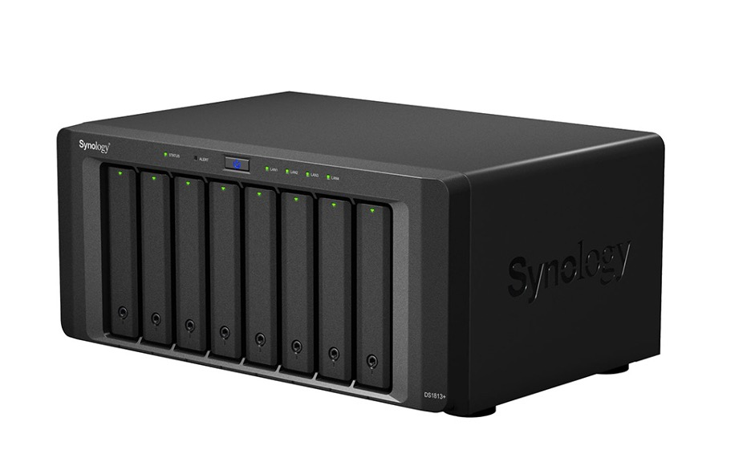
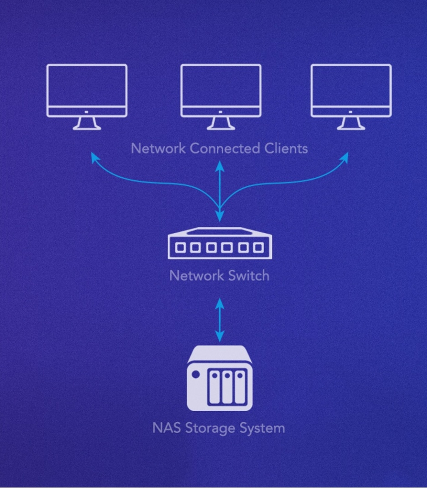
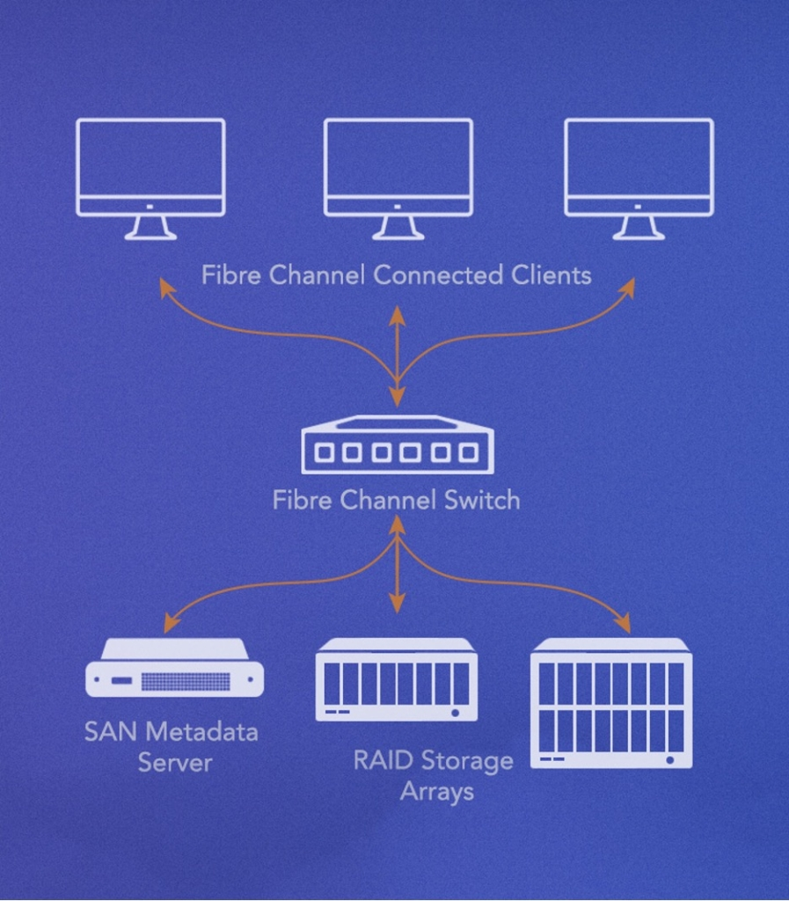

# Network Attached Storage (NAS) and Storage Area Networks (SAN)

**YouTube:** [What is a NAS as Fast As Possible](https://youtu.be/ZwhT-KI16jo?si=oOFDWDl3x8VTufBT), [What is a STORAGE AREA NETWORK | SAN Physical overview](https://youtu.be/7eGw4vhyeTA?si=k0ytEUb9I5pjqqEn)

**Resource:** [NAS vs SAN - What are the differences?](https://www.backblaze.com/blog/whats-the-diff-nas-vs-san/)

Network Attached Storage (NAS) is a file-level data storage device that connects to a network, allowing multiple devices to access files from a central location. 

A Storage Area Network (SAN) is a dedicated, high-speed network that provides block-level access to storage devices, appearing to servers as locally attached disks.

### TL;DR

- Network Attached Storage (NAS) is a file-level data storage device that connects to a network, allowing multiple devices to access files from a central location. 

- A Storage Area Network (SAN) is a dedicated, high-speed network that provides block-level access to storage devices, appearing to servers as locally attached disks.

## Basic Definitions: What Is NAS?

NAS is a device or devices with a large data storage capacity that provides file-based data storage services to other devices on a network. Usually, they also have a client or web portal interface that’s easy to navigate, as well as services like QNAP’s Hybrid Backup Sync or Synology’s Hyper Backup to help manage your files. In other words, NAS is synonymous with user-friendly file sharing. 

At its core, NAS operates as a standalone device connected to a network, offering shared access to files and folders. NAS volumes appear to the user as network-mounted volumes. The files to be served are typically contained on one or more hard drives in the system, often arranged in RAID arrays. Generally, the more drive bays available within the NAS, the larger and more flexible storage options you have.

### Key Characteristics

- **File-Level Access:** NAS provides file-level access, ideal for environments where collaborative work and content sharing are paramount.

- **Simplicity:** NAS solutions offer straightforward setups and intuitive interfaces, making them accessible to users with varying levels of technical expertise.

- **Scalability:** While NAS devices can be expanded by adding more drives, there may be limitations in terms of performance and scalability for large-scale enterprise use.

### How NAS Works?

The NAS device itself is a network node—much like computers and other TCP/IP devices, all of which maintain their own IP address—and the NAS file service uses the ethernet network to send and receive files. This system employs protocols like network file system (NFS) and server message block (SMB), enabling seamless data exchange between multiple users.

### Business Benefits of NAS

NAS devices are designed to be easy to manage, making them a popular choice for home users, small businesses, and departments seeking straightforward centralized storage. They offer an easy way for multiple users in multiple locations to access data, which is valuable when users are collaborating on projects or need to share information.

### Pros of NAS

- Relatively inexpensive.

- A self-contained solution.

- Easy administration.

- Remote data availability and 24/7 access.

- Wide array of systems and sizes to choose from.

- Drive failure-tolerant storage volumes.

- Automatic backups to other devices and the cloud.

### Cons of NAS

- Performance degrades as more users access the system simultaneously

- Scalability has a ceiling, and eventually requires a full hardware upgrade (processor, memory, network connections)

- Ethernet packet transmission can introduce latency, especially under heavy network traffic

- Even minor latency can disrupt data-intensive workflows like video editing and large file transfers

## Basic Definitions: What is SAN?

On the other end of the spectrum, SANs are engineered for high-performance and mission-critical applications. They function by connecting multiple storage devices, such as disk arrays or tape libraries, to a dedicated network that is separate from the main local area network (LAN). This isolation ensures that storage traffic doesn’t interfere with regular network traffic, leading to optimized performance and data availability.

Unlike NAS, a SAN operates at the block level, allowing servers to access storage blocks directly. This architecture is optimized for data-intensive tasks like database management and virtualization or video editing, where low latency and consistent high-speed access are essential.

### Key Characteristics:

- **Block-Level Access:** SANs provide direct access to storage blocks, which is advantageous for applications requiring fast, low-latency data retrieval.

- **Performance:** SANs are designed to meet the rigorous demands of enterprise-level applications, ensuring reliable and high-speed data access.

- **Scalability:** SANs offer greater scalability by connecting multiple storage devices, making them suitable for businesses with expanding storage needs.

### How does SAN work?

A SAN is built from a combination of servers and storage over a high speed, low latency interconnect that allows direct Fibre Channel (FC) connections from the client to the storage volume to provide the fastest possible performance. The SAN may also require a separate, private ethernet network between the server and clients to keep the file request traffic out of the FC network for even more performance.

By joining together the clients, SAN server, and storage on a FC network, the SAN volumes appear and perform as if it were a directly connected hard drive. Storage traffic over FC avoids the TCP/IP packetization and latency issues, as well as any LAN congestion, ensuring the highest access speed available for media and mission critical stored data.

### Business Benefits of SAN

The primary strength of a SAN is that it allows simultaneous shared access to shared storage that becomes faster with the addition of storage controllers. SANs are optimized for data-intensive applications. For example, hundreds of video editors can simultaneously access tens of GB per second of storage  without straining the network. 

SANs can be easily expanded by adding more storage devices, making them suitable for growing storage needs. Storage resources can be efficiently managed and allocated from a central location. SANs also typically include redundancy and fault tolerance mechanisms to ensure data integrity and availability.

### Pros of a SAN:

- Extremely fast data access with low latency.

- Relieves stress on a local area network.

- Can be scaled up to the limits of the interconnect.

- Operating system level (“native”) access to files.

- Often the only solution for demanding applications requiring concurrent shared access.

### Limitations of a SAN:

- High upfront cost for Fibre Channel (FC) network infrastructure

- Requires a separate ethernet network for metadata file requests

- Complex setup and ongoing administration

- Typically requires dedicated IT staff

## The Main Difference between NAS and SAN

| | NAS | SAN |
|---|---|---|
| **Use case** | Often used in homes and small to medium sized businesses. | Often used in professional and enterprise environments. |
| **Cost** | Less expensive. | More expensive. |
| **Ease of administration** | Easier to manage. | Requires more IT administration. |
| **How data is accessed** | Data accessed as if it were a network-attached drive. | Servers access data as if it were a local hard drive. |
| **Speed** | Speed is dependent on local TCP/IP ethernet network, typically 1GbE to 10GbE but can be up to 25GbE or even 40GbE connections, and affected by the number of other users accessing the storage at the same time. Generally slower throughput and higher latency due to the nature of ethernet packetization, waiting for the file server, and latency in general. | High speed using Fibre Channel, most commonly available in 16 Gb/s to 32 Gb/s however newer standards can go up to 128 Gb/s. FC can be delivered via high speed ethernet such as 10Gbit or 40Gbit+ networks using protocols such as FCoE and iSCSI. |
| **Network connection** | SMB/CIFS, NFS, SFTP, and WebDAV. | Fibre Channel, iSCSI, FCoE. |
| **Scalability** | Lower-end not highly scalable; high-end NAS scale to [petabytes](https://www.backblaze.com/blog/150-petabytes-of-cloud-storage/) using clusters or scale-out nodes. | Can add more storage controllers, or expanded storage arrays allowing SAN admins to scale performance, storage, or both. |
| **Networking method** | Simply connects to your existing ethernet network. | Simply connects to your existing ethernet network. |
| **Simply connects to your existing ethernet network.** | Entry level systems often have a single point of failure, e.g. power supply. | Fault tolerant network and systems with redundant functionality. |
| **Limitations** | Subject to general ethernet issues. | Behavior is more predictable in controlled, dedicated environments. |

