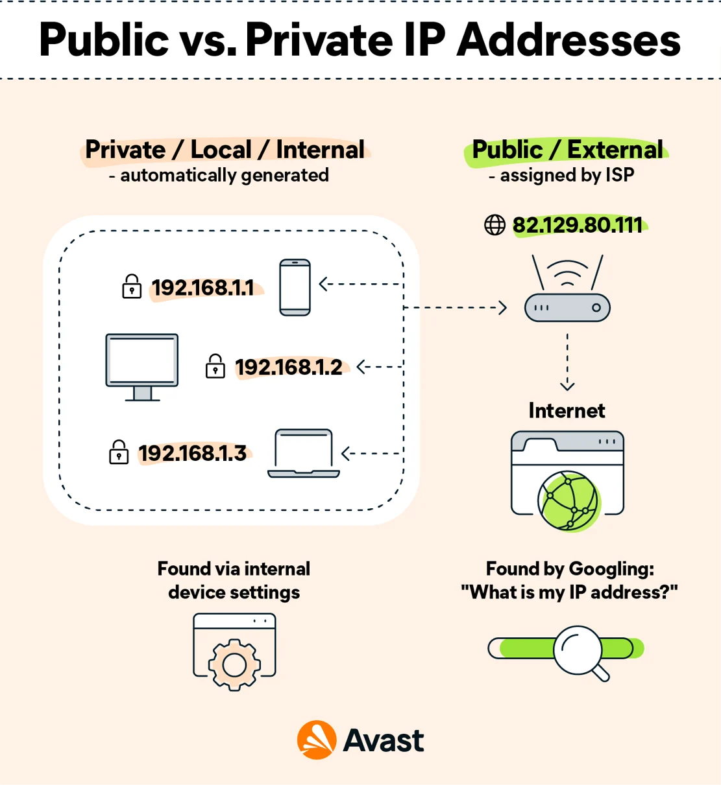
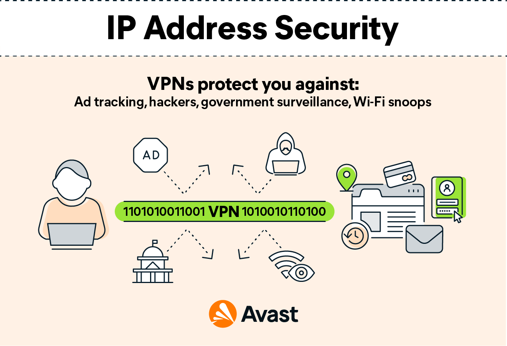

# Public vs Private IP Address

**YouTube:** [What is the Difference Between Public & Private IP? I Teltonika](https://youtu.be/R6Czae6Iow4?si=mofvG4t6gwoGzdL4)

**YouTube:** [Private Vs Public IP Address](https://youtu.be/po8ZFG0Xc4Q?si=CkspuhQLgi4erklO)

**Article:** [Public vs. Private IP Addresses: What’s the Difference?](https://www.avast.com/c-ip-address-public-vs-private)

## What is a Public IP address?

A public IP address is an IP address that can be accessed directly over the internet and is assigned to your network router by your internet service provider (ISP). Your personal device also has a private IP that remains hidden when you connect to the internet through your router’s public IP.

Using a public IP address to connect to the internet is like using a P.O. box for your snail mail, rather than giving out your home address. It’s a little bit safer, but a lot more visible.

### How does a public IP address differ from an external IP address?

The terms public IP address and external IP address are essentially interchangeable. No matter which phrasing you prefer, the function is the same: **a public (or external) IP address helps you connect to the internet from inside your network, to outside your network.**

### Are Public IP traceable?

Yes. Public IP addresses can be traced back to your ISP, which can potentially reveal your general geographical location. When advertisers, governments, or hackers know where you’re connecting from, it’s easier for them to follow what you do online.

Websites also use IP tracking to analyze online behavior patterns, making it easier for them to determine if the same individual visits the site repeatedly. Websites can then use these patterns to predict your preferences.

To browse the internet more anonymously, you can hide your IP address by connecting through a security protocol: a proxy server, a VPN, or the Tor browser. You can also try your luck with private browsers, but most of them don’t provide the kind of disguise your IP address needs.

These days, the quickest way to ensure your IP address is safely hidden online is to connect with a VPN. Avast Premium VPN will encrypt your connection automatically — keeping your web surfing private, your online banking secure, and your preferences to yourself.

## What is a Private IP Address?

A private IP address is the address your network router assigns to your device. Each device within the same network is assigned a unique private IP address (sometimes called a private network address) — this is how devices on the same internal network talk to each other.

Private IP addresses let devices connected to the same network communicate with one another without connecting to the entire internet. By making it more difficult for an external host or user to establish a connection, private IPs help bolster security within a specific network, like in your home or office. This is why you can print documents via wireless connection to your printer at home, but your neighbor can’t send their files to your printer accidentally.

Local IP addresses are also how your router directs internet traffic internally — in other words, how your router returns search results to your computer rather than another device connected to your network (like your phone or your partner’s phone).

### Private vs. local vs. internal IP addresses

Similar to how public IP address and external IP address are interchangeable terms, private IP address and internal IP address are interchangeable terms as well. A private IP address is also often called a local IP address — it’s up to you which term you use.

### Are private IP addresses traceable?

Yes, private IP addresses are traceable, but only by other devices on your local network. Each device connected to your local network has a private IP address, and each device’s private IP address can be seen only by other devices within that network. But unlike the public IP address that your router uses to connect your device to the internet, your private IP address cannot be seen online.

## Key differences between public and private IP addresses

The main difference between public and private IP addresses is how far they reach, and what they’re connected to. A public IP address identifies you to the wider internet so that all the information you’re searching for can find you. A private IP address is used within a private network to connect securely to other devices within that same network.

### Public and private IP address ranges

Your private IP address exists within specific private IP address ranges reserved by the Internet Assigned Numbers Authority (IANA) and should never appear on the internet. There are millions of private networks across the globe, all of which include devices assigned private IP addresses within these ranges:

- Class A: 10.0.0.0 — 10.255.255.255

- Class B: 172.16.0.0 — 172.31.255.255

- Class C: 192.168.0.0 — 192.168.255.255

These might not seem like wide ranges, but they don’t really need to be. Because these IP addresses are reserved for private network use only, they can be reused on different private networks all over the world — without consequence or confusion.

And don’t be surprised if you have a device or two at home with a so-called 192 IP address, or a private IP address beginning with 192.168. This is the most common default private IP address format assigned to network routers around the globe.

Unsurprisingly, the public IP address range encompasses every number not reserved for the private IP range. Since a public IP address is a unique identifier for each device connected to the internet, it needs to be just that: unique.

### Summarizing the differences between private and public IP addresses

| Feature                  | Public IP Address                                                      | Private IP Address                                                                                |
| ------------------------ | ---------------------------------------------------------------------- | ------------------------------------------------------------------------------------------------- |
| **Reach**                | External (global) reach                                                | Internal (local) reach                                                                            |
| **Purpose**              | Used for communicating outside your private network, over the internet | Used for communicating within your private network, with other devices in your home or office     |
| **Uniqueness**           | A unique numeric code never reused by other devices                    | A non-unique numeric code that may be reused by other devices in other private networks           |
| **How to Find**          | Found by Googling: "What is my IP address?"                            | Found via your device's internal settings                                                         |
| **Assignment & Control** | Assigned and controlled by your internet service provider              | Assigned to your specific device within a private network                                         |
| **Cost**                 | Not free                                                               | Free                                                                                              |
| **Address Range**        | Any number not included in the reserved private IP address range       | `10.0.0.0` — `10.255.255.255`; `172.16.0.0` — `172.31.255.255`; `192.168.0.0` — `192.168.255.255` |
| **Example**              | `8.8.8.8`                                                              | `10.11.12.13`                                                                                     |

## IP Address Security

If you need to use a VPN to connect to the internet, your public IP address will change each time you connect — each new connection is encrypted to hide your IP address and keep prying eyes away.

At the end of the day, the reason your public IP address works for you is the same reason it may work against you: it’s completely visible online. The best way to protect your real IP address is to use a VPN, which routes all your online traffic through a separate server nowhere near your actual location.
