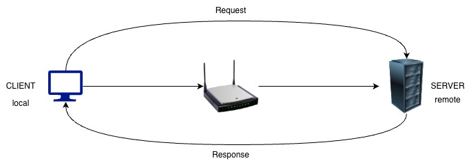

# Networking Knowledge

## 1. What are Network Protocols

Resource: https://www.solarwinds.com/resources/it-glossary/network-protocols

### What are Network Protocols?

Network protocols are a set of rules outlining how connected devices communicate across a network to exchange information easily and safely.

### Types of Network Protocols

#### 1. Network Communication Protocols:

These Protocols determine the rules and formats to transfer data across networks.

Communication protocols govern various aspects of analog and digital communication, such as:

- Syntax
- Authentication
- Semantics
- Error Detection

##### Key Protocols include:

- Hyper-Text Transfer Protocol (HTTP): Protocol which allows communication between a server and browser.

    

- Transmission Control Protocol (TCP): Connection Oriented Protocol that helps in sequential transmission of data packets to ensure data reaches the destination on time and without duplication.

- Internet Protocol (IP): Facilitates routing the data packets across networks. IP contains addressing and control information to deliver packets across a network. It works along with TCP. While it ensures delivering the packets to the right address, TCP aligns them in the right order.

- User Datagram Protocol (UDP): UDP is a connectionless protocol that doesn't ensure a connection between the application and server before transmitting a message. Usecases: Broadcasts and multicast connections.

- File Transfer Protocol (FTP): Allows file sharing between servers by establishing two TCP connections, one for data transfer and the other for control. The data transfer connection transfers the files while the control connection transfers control information such as passwords to ensure data retrieval in case of data loss.

#### 2. Network Security Protocols:

These protocols ensure safe data transmission over the network connections. These define the procedures to secure data from any unauthorised access. These protocols leverage encryption and cryptography to safeguard.

##### Most widely used network security protocols:

- Secure File Transfer Protocol (SFTP): Secure File transfer across a network by using public-key encryption and authenticating the client and server.

- Hyper-Text Transfer Protocol Secure (HTTPS): Ensures the security of data transmitted between the browser and server through data encryption.

- Secure Socket Layer (SSL): Secures internet connections and safeguard sensitive data using encryption. SSL protocol enables both server-client communication and server-server communication.

#### 3. Network Management Protocols:

Network managers require standard policies and procedures to manage and monitor the network for maintaining smooth communication. Network management protocols ensure quick troubleshooting and optimal performance across the network.

##### Essential Network Protocols Management:

- Simple Network Management Protocol (SNMP): Helps administrators manage network devices by monitoring endpoint information to proactively track network performance and pinpoint network glitches for quick troubleshooting.

- Internet Control Message Protocol (ICMP): Helps diagnose network connectivity issues. Network devices employ ICMP for sending error messages, highlighting congestion and timeouts, and transmitting other operational information to assist in network troubleshooting.

### How do network protocols work?

The most popular model, the Open Systems Interface (OSI), demonstrates how computer systems communicate over a network. This seven-layer model visualizes the communication process between two network devices across seven layers.

### What are OSI model layers?

1. Layer 1 - Physical Layer: The first layer enables physical connection between the two network devices. It facilitates data transmission in bits while managing bit rate control, cabling or wireless technology, voltage, and topography, among other things.

2. Layer 2 - Data Link Layer: Two physically connected nodes on a network require a connection. The data link layer helps create  and terminate a connection by breaking up packets into frames and transmitting them from source to destination. This layer fixes problems generated due to damaged, duplicate, or lost frames.

3. Layer 3 - Network Layer: This layer fulfills two primary functions. The first function consists of splitting up segments into network packets and putting the packets back together at the receiver’s end. The second ensures the transmission of packets across the physical network via the most optimal route.

4. Layer 4 - Transport Layer: Data incoming in its raw state from the preceding layer is broken into “segments” and is reassembled on the receiving end at the transport layer. This layer manages the flow control by transmitting data to match the receiving device’s connection speed and monitors error control by ensuring that the received data is correct.

5. Layer 5 - Session Layer: This layer establishes a communication channel called a session between the devices that want to exchange data. The session layer opens sessions and ensures they function effectively during data transmission and closes the respective sessions once the communication ends.

6. Layer 6 - Presentation Layer: This layer arranges data for the application layer by ensuring the correct representation concerning information syntax and semantics. It also controls file-level security by defining how the connected devices should encrypt and compress data to provide accurate data transmission at the receiver’s end.

7. Layer 7 - Application Layer: The top layer of the network, the application layer, is accessed by end-user software such as web browsers and email clients. Protocols at this layer allow applications to send and receive information and present easy-to-understand and relevant data to users.

### How do network protocols function in each OSI model layer?

- Layer 1: Physical Layer Protocols: These protocols provide an interface between devices and network medium.

- Layer 2: Data Link Layer Protocols: The protocols operating at this level ensure the framing of packets while proactively identifying and rectifying packet transmission errors.

- Layer 3: Network Layer Protocols: By leveraging the right set of network layer protocols, administrators route packets efficiently while managing the network flow and congestion to prevent network resource depletion.

- Layer 4: Transport Layer Protocols: These protocols ensure reliable end-to-end packet delivery across networks in the right sequence at the receiving end.

- Layer 5: Session Layer Protocols: Protocols at the session layer help manage dialogues and user sessions by seamlessly establishing and terminating sessions for communication exchange.

- Layer 6: Presentation Layer Protocols: These protocols are necessary to encode and decode data to smoothly mask the variations in data formats across different systems.

- Layer 7: Application Layer Protocols: These protocols help transform user requests to network-friendly formats.

