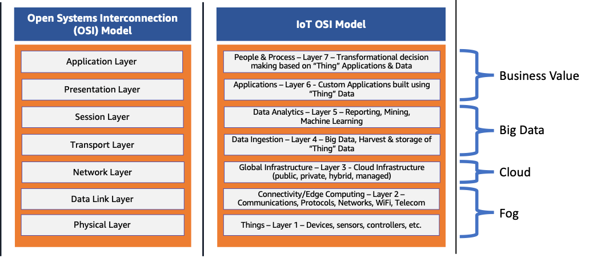

# OSI Model

> A conceptual framework that divides network communication into seven layers.

**Reference:** [AWS – What is the OSI Model?](https://aws.amazon.com/what-is/osi-model/)

---

## Table of Contents

- [What is the OSI Model?](#what-is-the-osi-model)
- [Why is the OSI Model Important?](#why-is-the-osi-model-important)
- [The Seven Layers](#the-seven-layers)
- [How Communication Happens](#how-communication-happens)
- [Alternatives: The TCP/IP Model](#alternatives-the-tcpip-model)

---

## What is the OSI Model?

The **Open Systems Interconnection (OSI) model** is a conceptual framework that divides network communication functions into **seven layers**.

Sending data over a network is complex: diverse hardware and software technologies must work together across geographical and political boundaries. The OSI model provides a **universal language for computer networking**, so different technologies can communicate using standard protocols.

Every technology in a given layer must provide certain capabilities and perform specific functions. Higher layers benefit from **abstraction**: they can use lower-level technologies without worrying about implementation details.

## Why is the OSI Model Important?

The layers of the OSI model encapsulate every type of network communication across both software and hardware components. It was designed so that two standalone systems can communicate through standardised interfaces or protocols based on the current layer of operation.

### Benefits

1. **Shared understanding of complex systems**
   Engineers can organize and model complex networked architectures by separating each component by its main functionality. Decomposing a system into smaller, manageable parts makes it easier to understand as a whole.

2. **Faster research and development**
   Engineers know which layer(s) they are developing for when building networked systems, and can take advantage of repeatable processes and protocols.

3. **Flexible standardization**
   The model does not specify *which* protocols to use between levels, but rather the *tasks* protocols perform. This lets people rapidly understand, build, and decompose highly complex systems without prior knowledge of them. In modern applications, lower networking levels are abstracted away to simplify design and development.

## The Seven Layers

| # | Layer | Focus | Examples |
|---|-------|-------|----------|
| 7 | **Application** | Application-specific communication methods | HTTP, HTTPS, POP3, SMTP |
| 6 | **Presentation** | Syntax and structure of data | HTML, JSON, CSV |
| 5 | **Session** | Coordination between two applications in a session | NFS, SMB |
| 4 | **Transport** | Ordered, error-free, reliable delivery | TCP, UDP |
| 3 | **Network** | Routing, forwarding, addressing | IPv4, IPv6 |
| 2 | **Data Link** | Connecting two machines; frames, flow and error control | Ethernet, MAC, LLC |
| 1 | **Physical** | Physical medium and signal transmission | Fiber-optic, copper, air, Bluetooth, NFC |

### 1. Physical Layer
Covers the physical communication medium and the technologies used to transmit data across it. Data communication is the transfer of digital and electronic signals through channels such as fiber-optic cables, copper cabling, and air. Standards here include Bluetooth, NFC, and data transmission speeds.

### 2. Data Link Layer
Covers the technologies that connect two machines across a network where the physical layer already exists. It manages **data frames** (digital signals encapsulated into data packets), with a focus on flow control and error control. Ethernet is an example standard. The layer is often split into two sub-layers:
- **Media Access Control (MAC)**
- **Logical Link Control (LLC)**

### 3. Network Layer
Concerned with **routing, forwarding, and addressing** across a dispersed network or multiple connected networks. It may also manage flow control. Across the internet, **IPv4** and **IPv6** are the main protocols.

### 4. Transport Layer
Ensures data packets arrive **in the right order, without loss or errors**, or can be recovered if needed. Flow control and error control are common focuses. Key protocols:
- **TCP (Transmission Control Protocol):** near-lossless, connection-based. Used where all data must be intact (e.g. file sharing).
- **UDP (User Datagram Protocol):** lossy, connectionless. Used where retaining every packet is less critical (e.g. video streaming).

### 5. Session Layer
Responsible for network coordination between two separate applications in a session. A session manages the beginning and ending of a one-to-one application connection, and synchronization conflicts. Common protocols: **NFS** (Network File System) and **SMB** (Server Message Block).

### 6. Presentation Layer
Concerned with the **syntax of the data** that applications send and consume. HTML, JSON (JavaScript Object Notation), and CSV (Comma Separated Values) are all languages describing data structure at this layer.

### 7. Application Layer
Concerned with the specific type of application and its standardized communication methods. For example, browsers communicate using **HTTP/HTTPS**, and email clients use **POP3** and **SMTP**.

> **Note:** Not all systems that use the OSI model implement every layer.

## How Communication Happens

Chaining the layers together lets complex data be sent from one high-level application to another:

1. The sender's **application layer** passes data down to the next lower layer.
2. Each layer adds its own **headers and addressing** to the data before passing it on.
3. Data moves down the layers until it is transmitted through the **physical medium**.
4. At the other end, each layer processes the data according to the headers for that level.
5. At the receiver, data moves **up** the layers and is gradually unpacked until the application receives it.

## Alternatives: The TCP/IP Model

The TCP/IP model, as described here, has five layers:

1. Physical
2. Data Link
3. Network
4. Transport
5. Application

Layers like physical, network, and application appear to map directly to the OSI model, but the mapping isn't exact. The TCP/IP model most accurately reflects the structure and protocols of the **internet**.

The OSI model remains popular for explaining how networking works from a holistic, educational perspective, while TCP/IP is more commonly used in practice.